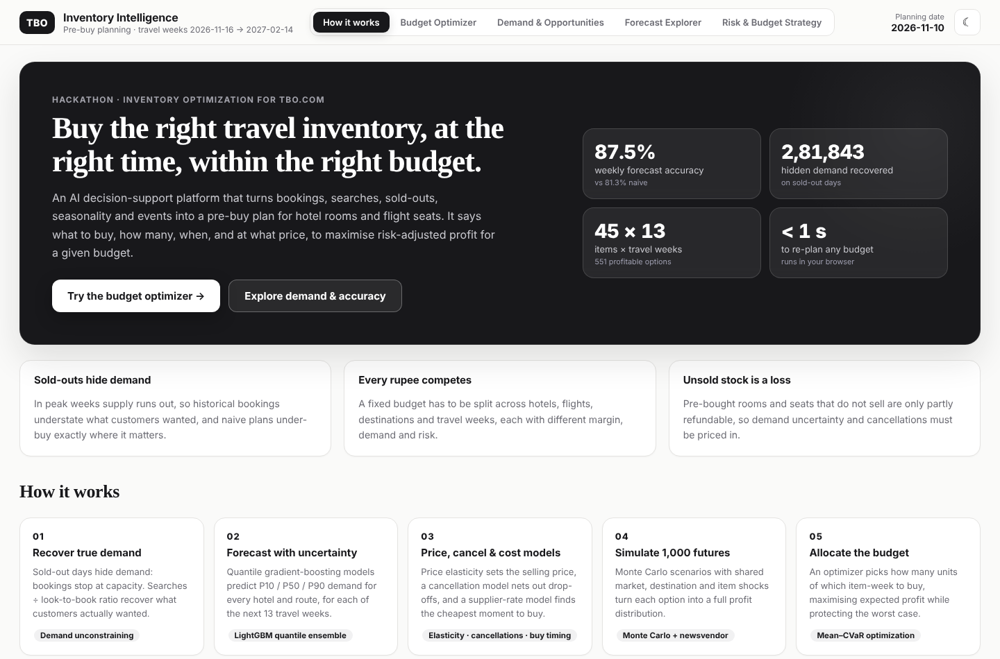
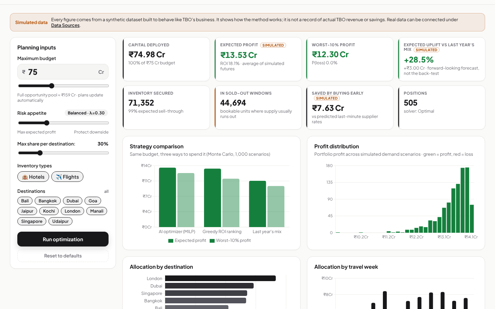
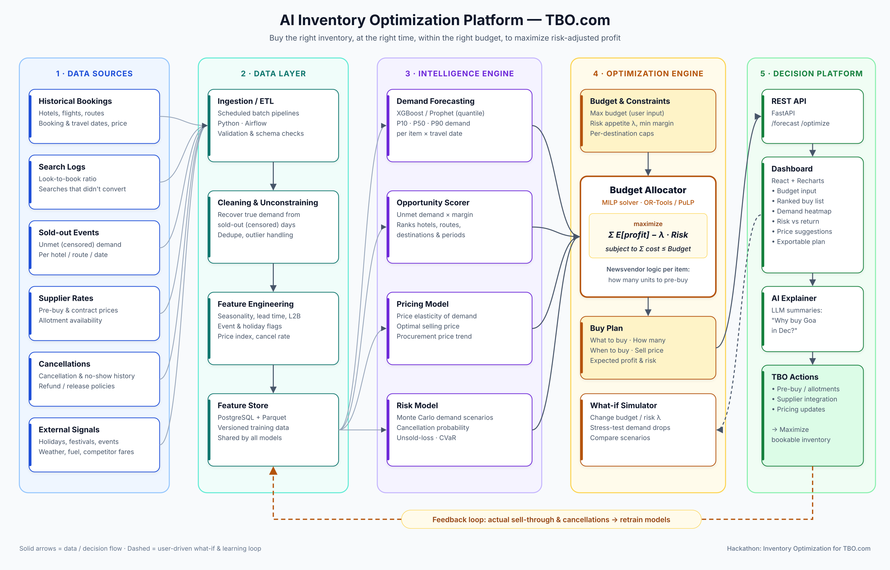

# TBO Inventory Intelligence — AI Pre-buy Optimizer

**Team Void** · Hackathon: Inventory Optimization for TBO.com

> **Hackathon challenge:** Inventory Optimization for TBO.com.
> Buy the right inventory, at the right time, within the right budget, to maximise risk-adjusted profit.

You give the system a **maximum budget** and a **risk appetite**. It returns a ranked **buy plan** for hotel room-nights and flight seats. For each position the plan says:

- **what** to buy (hotel or route, and travel week)
- **how many** units
- **when** to buy it (buy-by date)
- **what price** to sell at

Every position comes with expected profit, worst-case profit and a plain-English explanation.

## Submission materials

Everything for the submission is in this repository:

| Item | Where |
|---|---|
| Live prototype | https://tbo-inventory-optimizer-sggo.vercel.app (FastAPI + MILP on Vercel) |
| Code | this repository: `backend/` (models, optimizer, API) and `frontend/` (React app) |
| **10-slide presentation** | [`docs/TBO_Inventory_Intelligence_deck.pdf`](docs/TBO_Inventory_Intelligence_deck.pdf) · PowerPoint: [`docs/TBO_Inventory_Intelligence_deck.pptx`](docs/TBO_Inventory_Intelligence_deck.pptx) · [speaker notes](docs/TBO_Inventory_Intelligence_speaker_notes.md) |
| **Video pitch (no voice, on-screen captions)** | [`docs/TBO_Inventory_Intelligence_pitch_silent.mp4`](docs/TBO_Inventory_Intelligence_pitch_silent.mp4) (3:31, 1080p) |
| **Project report** | [`docs/TBO_Inventory_Intelligence_report.pdf`](docs/TBO_Inventory_Intelligence_report.pdf) (9 pages) |
| Earlier video with voice-over | [`docs/TBO_Inventory_Intelligence_pitch.mp4`](docs/TBO_Inventory_Intelligence_pitch.mp4) (2:11; earlier version, earlier figures) |
| Video pitch script | [`docs/video_pitch_script.md`](docs/video_pitch_script.md) |
| Architecture diagram | `docs/architecture.png` (editable `docs/architecture.svg`) |





---

## How it maps to the problem statement

| Objective in the brief | How this system does it |
|---|---|
| **Predict demand** using bookings, search data and external signals | An ensemble of LightGBM **quantile** models (P10/P50/P90): daily models on a log target with a seed-bagged median, blended with a direct weekly model. All are trained on *unconstrained* demand. Features cover seasonality, holidays and festivals, destination events, day of week, growth trend, same week last year, recent demand level and a **lagged search (look-to-book) index**. Intervals are **calibrated** to 80% coverage. |
| Use **sold-outs** and **look-to-book** | **Demand unconstraining:** on sold-out days, bookings = capacity, not demand, so true demand is recovered from searches ÷ the item's look-to-book ratio. This cuts sold-out-day demand error from **36% → 9%**. |
| **Identify opportunities** (inventory, destination, travel time, procurement price) | An opportunity score combines ROI at the optimal quantity, historical sold-out pressure and forecast confidence. A heatmap shows destination × week. |
| **Optimize investments** within a given budget | **Mixed-integer linear program** (PuLP + HiGHS) with a budget constraint, a per-destination diversification cap and ordered quantity blocks. |
| **Maximize profitability:** purchase timing, quantities, selling prices | **Timing:** a supplier-rate model picks the cheapest feasible lead time and gives a buy-by date. **Quantity:** the newsvendor critical ratio sets Q\*. **Price:** grid search with estimated price elasticity. |
| **Manage risk** from uncertain demand, cancellations and unsold stock | **Monte Carlo** (1,000 correlated scenarios: global + destination + item shocks). The model includes a cancellation-rate model and the salvage value of released allotments. A **mean–CVaR objective** is set by the λ slider. |

## Architecture



```
data sources ─► data layer ─────────────► intelligence engine ──────────► optimization engine ─► API + dashboard
bookings        ETL                       demand forecast (quantile GBM)  newsvendor blocks     FastAPI
searches        demand unconstraining     cancellation model              MILP budget allocator React + Recharts
sold-outs       feature engineering       price elasticity + pricing      greedy / last-year    AI explanations
supplier rates  feature store             supplier-rate (timing) model    baselines, frontier
cancellations                             Monte Carlo risk + SHAP drivers
calendar/events
```

## Models, algorithms and techniques

| Step | Technique | File |
|---|---|---|
| Demand unconstraining | Look-to-book based censored-demand recovery | `pipeline/models.py::unconstrain` |
| Demand forecast | LightGBM quantile regression (α = 0.1/0.5/0.9) on log1p demand. The median is bagged over 3 seeds and blended (75/25) with a direct weekly quantile model. Backtested against a seasonal-naive baseline. | `models.py::DemandForecaster` |
| Interval calibration | Out-of-sample scaling of the P10–P90 spread (fit on one holdout window, applied to the next) | `models.py::DemandForecaster.calibrate` |
| Explainability | SHAP values (LightGBM `pred_contrib`) grouped into business drivers + optional Claude-written rationale | `models.py`, `explain.py` |
| Cancellations | LightGBM with cross-entropy objective on cancellation rate | `models.py` |
| Market selling price | LightGBM on log price with holiday / event / seasonality features. Gives a weekly market price that captures peak premiums; a monthly average misses the Christmas-week spike that supplier costs follow. | `models.py::fit_price_model` |
| Price elasticity | Per-item log-log regression on **unconstrained demand over all days**, with month / day-of-week / holiday / event controls. Dropping sold-out days would discard exactly the promotion days that sold out and bias the estimate. | `models.py` |
| Buy timing | LightGBM supplier-rate model (cost multiplier vs. lead time and season) → cheapest feasible lead time and buy-by date | `models.py`, `train.py` |
| Weekly demand distribution | Daily quantiles → weekly lognormal with intra-week correlation | `simulate.py` |
| Risk | Monte Carlo with shared global and destination shocks, so portfolio diversification is real | `simulate.py` |
| Quantity per item | Newsvendor critical ratio (p(1−c) − cost) / ((p(1−c) − cost) + cost(1 − salvage)) | `simulate.py` |
| Selling price | Grid search with market elasticity + a competitive (switching) elasticity, capped at +20% (rate-parity guardrail) | `simulate.py` |
| Budget allocation | MILP: maximize Σ[(1−λ)·E[ΔProfit] + λ·Tail[ΔProfit]]·x s.t. budget, destination caps, block ordering | `optimizer.py` |
| Baselines | Greedy ROI ranking; last-year revenue-proportional split | `optimizer.py` |
| Strategy views | Risk–return frontier (λ sweep) and budget curve (diminishing returns) | `optimizer.py` |

**Risk term detail.** `Tail[ΔProfit]` is the block's average marginal profit over a fixed set of portfolio stress scenarios: the worst 10% for a reference "buy everything" portfolio. Because every candidate shares that scenario set, the sum in the objective is exactly the plan's average profit in the stress scenarios. That makes it a linear, scenario-consistent CVaR proxy, so the MILP stays fast (< 1 s for ~5,000 binary variables).

## Accuracy (out-of-sample holdout 11 Aug → 9 Nov 2026)

Every model is scored on the last 91 days of history, which none of them saw in training. "Best possible" is the irreducible noise in the synthetic data: the error you would get even knowing the true expected demand.

| Model | Metric | Ours | Baseline | Best possible |
|---|---|---|---|---|
| **Weekly demand forecast** | WAPE | **12.5% (87.5% accurate)** | 18.7% (same week last year) | 10.2% |
| Daily demand forecast | WAPE | 28.6% | 40.2% | 26.0% |
| Forecast intervals | P10–P90 coverage (target 80%) | 81% daily · 80% weekly | 74% uncalibrated | 80% |
| Sold-out demand recovery | error on sold-out days | 9.0% | 36.3% (raw bookings) | 0% |
| Price elasticity | mean abs. error vs. truth | 0.154 (r = 0.84) | 0.308 (open-days-only method) | 0 |
| Supplier rates (buy timing) | MAPE | 1.8% | 6.5% (item × lead-time average) | – |
| Market selling price | weekly MAPE (peak days) | 2.6% (5.8%) | 3.3% (8.1%) — monthly average | – |
| Cancellations | weekly WAPE | 17.4% | 17.5% (item's historical rate) | – |

**No leakage:**
- Models use only what TBO would actually observe: bookings, searches, sold-outs, prices, cancellations, supplier quotes and the calendar.
- The generator's hidden parameters (true elasticity, base demand, and so on) are never used as features. They're used only to score the models.
- Every lagged feature is older than the 13-week forecast horizon.

**Train/test split (time-based):**
- Demand: trained on 37,755 item-days (24 Apr 2024 → 10 Aug 2026) and tested on 4,095 unseen item-days (11 Aug → 9 Nov 2026).
- A separate earlier window (12 May → 10 Aug 2026) calibrates the uncertainty ranges.
- The final model is retrained on all 41,850 item-days.

**What improved accuracy (v1 → v2):**
- Weekly error dropped from 14.1% to 12.5%, closing about 40% of the gap to the noise floor. The gains came from:
  - same-week-last-year and recent-level features
  - a log target, which suits demand's multiplicative structure
  - seed bagging
  - blending with a direct weekly model
- Elasticity error halved after fixing the selection bias from dropping sold-out days.
- Intervals were calibrated from 74% to about 80% coverage.

The cancellation model only matches the per-item baseline, because cancellation rates in this dataset barely vary beyond the item level. On real data with richer booking attributes, it has more to learn.

## Back-test: would the plan have made money?

This test plans as if today were **11 Aug 2026**:
- Every model is re-fitted using only data available that day, and the system plans the next 12 travel weeks.
- Each plan is then replayed against **what really happened**: real demand (adjusted for the plan's own selling price), real cancellation rates, and the supplier's real quote at the chosen lead time.

| Strategy (₹75 Cr budget) | Invested | Predicted profit | **Realised profit** | Realised ROI | Loss-making positions |
|---|---|---|---|---|---|
| **AI optimizer (MILP)** | ₹64.1 Cr | ₹12.04 Cr | **₹11.74 Cr** | **18.3%** | 3 of 495 |
| Greedy ROI ranking | ₹66.7 Cr | ₹12.10 Cr | ₹11.98 Cr | 18.0% | 4 |
| Last year's mix | ₹68.8 Cr | ₹7.63 Cr | ₹7.30 Cr | 10.6% | 95 |

**Takeaways:**
- Realised profit came within **3%** of the prediction, so the risk model is well calibrated.
- The AI plan earned **+61%** more than copying last year's mix.
- The greedy baseline earned ₹0.24 Cr more but needed **₹2.6 Cr more capital**; the optimizer's return per rupee is higher.
- It chose not to spend the last ₹10.9 Cr, because no remaining option added risk-adjusted profit. The app explains this under the KPIs whenever budget is left unused.
- The replay includes each supplier's actual confirmation failures (re-bought at the last-minute rate) and actual refunds on released stock.

**All results are on the synthetic dataset: they show the method works, they are not actual TBO profit or savings.** The realised back-test (+61%) and the forward-looking expected uplift (+28.5%, below) are different measurements and are shown separately in the app.

## Results on the bundled dataset (live plan, budget ₹75 Cr, λ = 0.3)

These figures now include supplier choice (6 suppliers with different prices, availability, reliability and refund terms), which is why they differ slightly from earlier versions.

| Strategy | Expected profit | Worst-10% avg profit | ROI |
|---|---|---|---|
| **AI optimizer (MILP)** | **₹13.53 Cr** | **₹12.30 Cr** | **18.1%** |
| Greedy ROI ranking | ₹13.32 Cr | ₹11.01 Cr | 17.8% |
| Last year's mix | ₹10.53 Cr | ₹9.36 Cr | 15.6% |

- Compared with last year's mix, the plan earns **+28.5% expected profit** (forecast, simulated), with a better worst case.
- Buying at the recommended lead times saves about **₹7.6 Cr** compared with last-minute supplier rates.
- About **44,000** of the bookable units the plan secures fall in weeks where supply historically sells out.
- **The New Year week (28 Dec) gets little budget on purpose.** The planning date is 10 Nov, so the longest available lead time is 45 days. Supplier quotes at that lead are about 18% above 120-day quotes, which is enough to wipe out the margin. Buying peak weeks earlier pays.

## Deploy to Vercel

The repo deploys as one Vercel project with two **services** (see `vercel.json`):

| Service | Root | Framework | Public path |
|---|---|---|---|
| `backend` | `backend/` | FastAPI (`app:app`) | `/api/*` |
| `frontend` | `frontend/` | Vite (React) | everything else |

1. Go to **vercel.com → Add New → Project → Import** this repository.
2. Click **Deploy**. No settings or environment variables are required.

The browser talks to the API on the same domain through relative `/api/...` URLs, so no service bindings are needed. The backend loads the trained models from `backend/artifacts/` (committed to the repo); to retrain, run `python -m pipeline.train` locally and commit the new artifacts. Optional: set `ANTHROPIC_API_KEY` on the project to get AI-written plan explanations.

Test locally with `vercel dev`, or run the backend and `npm run dev` as below.

A fully static, browser-only build is still available with `npm run build:site` (output `frontend/dist-site`).

## Run it

**Requirements:** Python 3.10+ and Node 18+. Node is only needed if you want to rebuild the UI; a built `frontend/dist` is included.

```bash
# one command (macOS / Linux) — Windows: run.bat
./run.sh
# open http://localhost:8000
```

Manual steps:

```bash
cd backend
pip install -r requirements-train.txt
python -m pipeline.generate_data   # ~5 s  → backend/data/*.csv
python -m pipeline.train           # ~2 min → backend/artifacts/ (includes forecast back-test + plan back-test)
uvicorn app:app --port 8000        # API + built dashboard

# UI development with hot reload (optional)
cd ../frontend && npm install && npm run dev   # http://localhost:5173 (proxies /api)
```

**Optional AI explanations:** `export ANTHROPIC_API_KEY=...` before starting the API. The drawer then also shows a Claude-written analyst note. Set `CLAUDE_MODEL` to change the model. Without a key, a deterministic template explanation is used.

## Static website (no server)

The project also builds into a fully static website that runs the whole decision engine in the browser:

```bash
cd backend && python export_static.py        # model outputs -> frontend/public/site/
cd ../frontend && npm run build:site         # -> frontend/dist-site/ (deploy anywhere: GitHub Pages, Netlify, Vercel, S3)
```

How the static build works:
- Model training happens offline in Python. The page ships the forecasts, the quantity blocks and 300 Monte Carlo scenarios per option (~5.6 MB).
- `src/engine.js` re-runs the budget allocation live for any budget, risk level, destination cap or filter. It allocates marginal value per rupee with destination caps, and matches the HiGHS MILP to within 0.2% on every tested setting.
- The site also adds a **"How it works"** landing page with the problem, pipeline, back-test and accuracy scorecard.
- The Claude-written explanations need the API key, so the static site uses the template explanations.

## UI and quality checks

**Themes and controls:**
- "Mono ink" black-and-white editorial theme. It starts in the visitor's system light or dark setting, and the dark mode uses soft greys rather than pure black. Green means profit and red means risk. The ☀/☾ button switches them and the choice is remembered.
- Motion animations, which are skipped for visitors who turn on reduced motion.
- Each tab has its own link (`#optimizer`, `#overview`, `#forecasts`, `#risk`).
- Plans re-solve automatically 350 ms after any input changes.
- The plan can be copied to the clipboard as CSV or downloaded.

**Accessibility:**
- Keyboard support: rows open with Enter, the explanation panel closes with Escape, focus is clearly visible, and there's a skip-to-content link.
- Every control and dialog has a label for screen readers.

**DOM audit:** `frontend/audit_dom.py` is a Playwright script with 62 checks: every one of the 9 tabs at desktop and phone width (renders, no horizontal overflow, carries a simulated-data label), no console errors, the accuracy metrics (WAPE, MAE, RMSE), the data-file validator and the what-if page. The FastAPI build passes all 62; the static build passes 61 (file checks need the server).

**Maths tests:** `cd backend && pytest tests` (8 tests) plus 24 live checks at `/api/verify`.

```bash
python frontend/audit_dom.py http://localhost:8000/
```

## API

| Method | Endpoint | Purpose |
|---|---|---|
| GET | `/api/summary` | Model metrics, heatmap, horizon |
| GET | `/api/opportunities?limit=&item_type=&destination=` | Ranked pre-buy opportunities |
| POST | `/api/optimize` | `{budget, risk_aversion, max_dest_share, item_types, destinations}` → plan, stats and baselines |
| POST | `/api/frontier` | Risk–return frontier for the same inputs |
| POST | `/api/budget-curve` | Profit and ROI across budgets |
| GET | `/api/forecast/{item_id}` | History, daily forecast and weekly inputs |
| POST | `/api/explain` | Explanation for one plan row |
| POST | `/api/scenario` | What-if: `{…optimize fields, shocks: [{kind, change, destination?, item_type?, item_id?, supplier_id?}], current_plan?}` → new plan, diff, value of re-planning |
| GET | `/api/signals/next?seq=` | Next simulated market signal for the auto re-planning demo |
| GET | `/api/suppliers` | Supplier scorecard and per-item comparison |
| GET | `/api/validation` | Holdout predicted vs actual, error metrics |
| POST | `/api/verify` | 24 maths checks on the plan for the given inputs |
| GET | `/api/data/contract` | Tables and columns needed for real data |
| POST | `/api/data/validate` | `{kind, csv}` → issues and warnings for one file |

Interactive docs: http://localhost:8000/docs

## Data

The PDF ships without data, so `pipeline/generate_data.py` creates a **realistic synthetic dataset**: 45 items (30 hotels across 10 destinations and 3 tiers, plus 15 flight routes), with daily data from Jan 2024 to Nov 2026. It contains the effects the brief mentions:

- seasonality, growth, Indian holidays and festivals, destination events (Sunburn, JLF, DSF, Singapore GP, …)
- price elasticity and promotions
- **supply shrinking in peaks**, which causes sold-outs
- searches that reflect true demand (look-to-book)
- cancellations
- lead-time-dependent supplier quotes

`_ground_truth.csv` holds true demand. It is used **only** to score the unconstraining step.

**To plug in real TBO data,** export the six tables in the data contract (`items`, `daily`, `calendar`, `rate_quotes`, `suppliers`, `supplier_history`). The **Data Sources** page lists every column and rule, gives empty templates and checks an uploaded file. Then:

```bash
python -m pipeline.ingest --source /path/to/export   # validates every table; copies only if all pass
python -m pipeline.train                              # retrains every model, re-runs both back-tests and the maths checks
```

## Features added in v3

| Area | What it does | Where |
|---|---|---|
| Supplier intelligence | Scores 6 suppliers per item from their request history: price vs benchmark, availability, confirmation rate, refund on release, minimum notice, free-release window. Each item-week is sourced from the supplier with the best expected profit after these effects. | Suppliers page, `pipeline/suppliers.py` |
| Cancellation risk | LightGBM cancellation model; expected cancellations reduce sellable demand in every scenario before quantities are chosen. | every position's explanation |
| Dynamic pricing | Selling price chosen per item-week from a price grid using the market price model and estimated elasticity. | Budget Optimizer, plan table |
| What-if simulation | Change demand, supplier prices, availability, market prices, cancellations, budget and risk; see the new plan, what changed and the value of re-planning vs keeping the current plan. | What-if & Re-planning |
| Automated re-planning | Incoming market signals (simulated in the demo) trigger a re-optimisation; the plan is switched only when the gain clears a threshold, with a log of every decision. | What-if & Re-planning |
| Explanations | Every position shows why it was picked, the quantity logic (newsvendor ratio), supplier comparison, price, expected profit and risk. | click any plan row |
| Unused budget | When budget is left over, the app explains why (no remaining unit adds risk-adjusted profit, destination caps, supplier capacity…). | Budget Optimizer |
| Accuracy & validation | One accuracy definition (1 − weekly WAPE) everywhere; MAE, RMSE, WAPE, bias per model; predicted vs actual on the holdout; interval coverage. | Accuracy & Validation |
| Maths verification | 24 independent checks recompute budget, profits, risk numbers and constraints from first principles, on the live plan; also `cd backend && pytest tests`. | Accuracy & Validation, `/api/verify` |
| Real-data path | Data contract, file validator, ingestion CLI. | Data Sources |

## Limitations and next steps

- **Live feeds:** the re-planner's signals are simulated; connect search logs, competitor rate feeds and supplier availability APIs.
- **Forward-looking searches:** use searches *for* future travel dates as a forecast feature. This is the strongest real-world signal.
- **Forecast accuracy ceiling:** weekly accuracy is 87.5% against a noise floor of 89.8% on this data; the remaining gap is mostly irreducible randomness. Real data with forward-looking searches is the main lever for further gains.
- **Hybrid sourcing:** model pre-buy as a top-up to dynamic sourcing and add supplier minimum-commitment rules.

## Project layout

```
backend/
  pipeline/
    config.py         planning clock, horizons, simulation settings
    generate_data.py  synthetic data
    models.py         unconstraining, forecasting, cancellations, elasticity, rates, SHAP
    simulate.py       Monte Carlo + newsvendor blocks
    candidates.py     forecasts + price/cost/cancel models → decision candidates (any planning date)
    plan_backtest.py  back-dated plan test against what really happened
    train.py          orchestrates the pipeline → artifacts/
    optimizer.py      MILP, baselines, frontier, budget curve
    explain.py        template + LLM explanations
  app.py              FastAPI
frontend/             React + Vite + Recharts dashboard
docs/                 architecture diagram, screenshots
```
